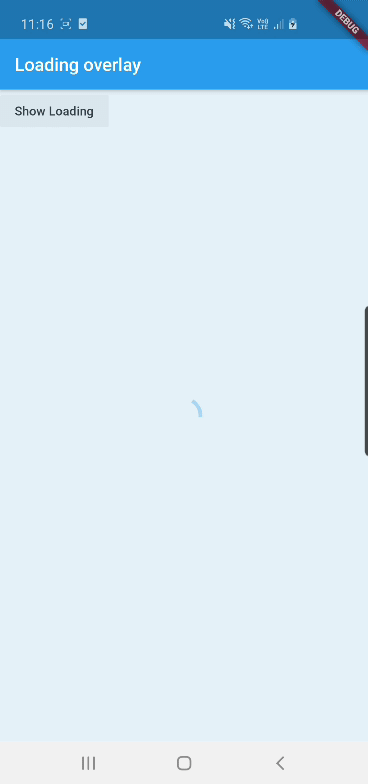

# loading_overlay

A simple widget wrapper to enable modal progress HUD (a modal progress indicator, HUD = Heads Up Display).

Started as a fork of [modal_progress_hud](https://pub.dev/packages/modal_progress_hud)
Inspired by [this](https://codingwithjoe.com/flutter-how-to-build-a-modal-progress-indicator/) article.


## Demo



*See example for details*


## Usage

Add the package to your `pubspec.yaml` file.

```yml
dependencies:
  loading_overlay: ^0.5.0
```

Next, import the library into your widget.

```dart
import 'package:loading_overlay/loading_overlay.dart';
```

Now, all you have to do is simply wrap your widget as a child of `LoadingOverlay`, typically a form, together with a boolean that is maintained in local state.

```dart
...
bool _isSaving = false;
...

@override
Widget build(BuildContext context) {
  return Scaffold(
     body: LoadingOverlay(
      color: const Color(0x80000000),
      isLoading: _isSaving,
      child: Form(...),
      ),
  );
}
```

Alternatively, show the overlay until a Future completes. Create and retain the
future in `initState` or an event handler, before building the overlay. Starting
the operation inside `build` would restart it whenever the parent rebuilds.

```dart
// saveFuture was created and retained before this build.
return LoadingOverlay.withFuture(
  future: saveFuture,
  color: const Color(0x80000000),
  child: Form(...),
);
```

Both success and failure dismiss the overlay. Await or handle the original future
to report errors to the user. The overlay does not change that future's result.
If you supply a different future, the overlay stays visible until the new future
finishes; completion of an older operation does not hide it. Rebuilding with the
same completed future does not restart the overlay.

The overlay blocks pointer taps while visible, including during its fade-out.
It does not disable keyboard or accessibility actions on the child. Guard async
handlers against duplicate submissions, as shown in the example's `signIn`
method; this also covers taps arriving before the overlay's first frame.


## Options

The current parameters are customizable in the constructor
```dart
LoadingOverlay({
  required bool isLoading,
  required Widget child,
  Widget progressIndicator = const CircularProgressIndicator(),
  Color? color,
});

// New: show overlay until a Future completes
LoadingOverlay.withFuture({
  required Future<void> future,
  required Widget child,
  Widget progressIndicator = const CircularProgressIndicator(),
  Color? color,
});
```

Update: See this [article](https://medium.com/@nocnoc/the-secret-to-async-validation-on-flutter-forms-4b273c667c03) on Medium about async form validation

See the [example application](https://github.com/java-james/loading_overlay/tree/master/example) source
for a complete sample app using the modal progress HUD. Included in the
example is a login form that guards against duplicate submissions during a
simulated async call.

## Compatibility and development

The library retains its Dart `>=2.12.0 <4.0.0` constraint and both existing
constructors. The default indicator, backdrop and 300 ms fade are unchanged.
Development tooling and the example require Flutter 3.32 / Dart 3.8 or newer.
Building the example for Android requires Flutter 3.50 and JDK 17 or newer.

The SDK Material import is intentionally retained for compatibility with existing
apps. Migration to the standalone `material_ui` package is reserved for a future
breaking release; its import deprecation is suppressed only at the relevant
imports.

Run checks from the repository root:

```sh
flutter pub get
flutter analyze
./scripts/runTests.sh
```

CI is configured to test Flutter 3.32 and 3.50, build the web and Android examples,
and run the library tests as a consumer on Flutter 2.0 / Dart 2.12. To run that
consumer check locally, put the Flutter SDK being checked on your `PATH` and run:

```sh
./scripts/test-compatibility.sh
```

The consumer check uses a temporary package so the library's development-only
lint dependency does not prevent testing older SDKs.


### Issues and feedback

Please file [issues](https://github.com/java-james/loading_overlay/issues/new)
to send feedback or report a bug. Thank you!

