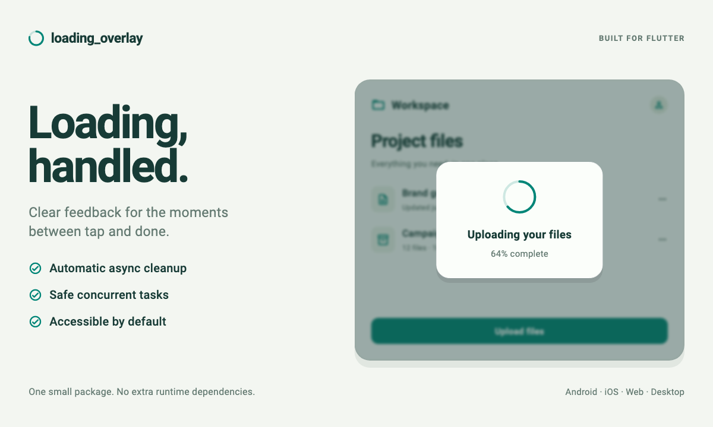
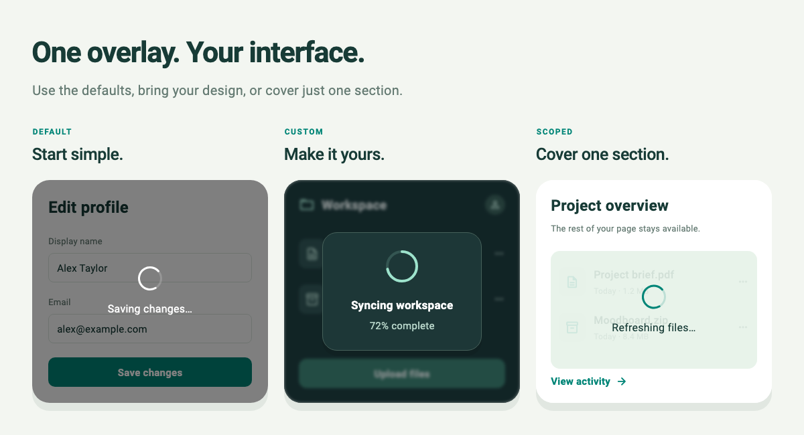

# loading_overlay

**Loading overlays that finish when your work does.**

Show a spinner with a boolean, follow a Future, or run overlapping async tasks
with automatic cleanup. Add progress, messages, and your own design. Modal
interaction, accessibility, and reduced motion are built in.

[](https://pub.dev/packages/loading_overlay)
[](https://github.com/java-james/loading_overlay/actions/workflows/ci.yml)
[API reference](https://pub.dev/documentation/loading_overlay/latest/) ·
[Interactive example source](example/lib/main.dart) · [Migration](doc/migration.md)



## Why loading_overlay?

- **One line of async cleanup:** `await controller.run(save)` hides on success,
  synchronous exceptions, and asynchronous errors, returning your original result.
- **Safe concurrent work:** each task owns its lifetime. The first task to finish
  cannot hide another task's overlay.
- **Local or app-wide:** wrap a card, a route, or your app builder. No singleton,
  retained `BuildContext`, navigation observer, or state management dependency.
- **Accessible interaction:** blocks underlying taps, keyboard focus, and screen
  reader actions; announces status and honors reduced motion.
- **No extra runtime dependencies:** only the Flutter SDK. Works with Material,
  Cupertino, and custom design systems, before and after Flutter's UI package split.
- **No flashing for fast tasks:** opt into a show delay and minimum visible time.

Flutter **3.27+**, Dart **3.6+**. Android, iOS, web, macOS, Windows, and Linux.
The interactive example uses Flutter 3.50 and `material_ui`; the library does not.
The published package includes its regression tests and integration examples.
See [tests and compatibility](#tests-and-compatibility) for checks you can inspect
and run.

## Install

```sh
flutter pub add loading_overlay
```

For the 0.7 API:

```yaml
dependencies:
  loading_overlay: ^0.7.0
```

```dart
import 'package:loading_overlay/loading_overlay.dart';
```

## Start with your existing state

```dart
LoadingOverlay(
  isLoading: isSaving,
  message: 'Saving changes…',
  child: yourPage,
)
```

This works with `setState`, Riverpod, Bloc, Provider, or any boolean state.
Wrap the whole `Scaffold` to include its app bar, or just a bounded section to
keep the rest of the page interactive. The overlay preserves its child's state.

## Let async work manage itself

Place a scope **inside your app**, around a page:

```dart
LoadingOverlayScope(child: CheckoutPage())
```

From a context **below** that scope:

```dart
final order = await context.loadingOverlay.run(
  () => submitOrder(),
  message: 'Placing your order…',
);
```

`run` returns the operation's result and propagates its original error and stack
trace. Catch errors as you normally would. It cleans up in either case. Overlapping
calls remain visible until **every** operation finishes.

Capture the controller before an async gap. If you use `context` afterwards, check
`context.mounted`. Guard duplicate submissions in your business logic: an overlay
does not deduplicate requests made before the next frame or through other callers.

### Progress and independently owned tasks

```dart
final task = context.loadingOverlay.start(message: 'Uploading…', progress: 0);
try {
  await uploadFile(onProgress: (sent, total) {
    task.update(message: 'Uploading…', progress: total > 0 ? sent / total : null);
  });
} finally {
  task.finish();
}
```

Progress is `null` (indeterminate) or a finite fraction from `0` to `1`.
The newest unfinished task supplies the message and progress. When it finishes,
any older unfinished task becomes visible again. `update` replaces both fields;
null clears a field. Late updates and repeated `finish` calls are harmless.

### Follow a Future you already have

Create and retain the future in `initState` or an event handler, **outside build**:

```dart
LoadingOverlay.withFuture(
  future: saveFuture,
  message: 'Saving…',
  child: yourPage,
)
```

Accepts a Future of any result type. Success and failure both dismiss it. Handle
errors on the original future. Replacing the future starts a new loading cycle;
stale completions cannot hide it. Rebuilding with the same completed future keeps
it hidden.

### Control it without a BuildContext

```dart
final loading = LoadingOverlayController(); // Own this in State or your DI scope.

// In build:
LoadingOverlay.controlled(controller: loading, child: yourPage)

// In an event handler or service:
await loading.run(fetchData, message: 'Refreshing…');

// In the owner's dispose:
loading.dispose();
```

For manual integration, `show(message: ...)` / `hide()` manage one idempotent
manual task. `hide()` cannot dismiss tasks created by `run` or `start`.
`reset()` clears all presentation; it does **not** cancel underlying operations.
A scope owns and disposes its implicit controller. Supplied controllers remain
caller-owned. Controllers expose a `ValueListenable<LoadingOverlayData>`.

## App-wide overlays and navigation

Wrap the navigator child supplied to `MaterialApp.builder`, `MaterialApp.router`
or `CupertinoApp.builder`:

```dart
MaterialApp(
  builder: (context, child) => LoadingOverlayScope(child: child!),
  home: const LoadingOverlayBackGuard(child: HomePage()),
)
```

The builder placement covers all routes and dialogs in that navigator. You can
supply a controller to the scope to call it without context. Compose with any
existing builder, preserving its child.

A scope **inside a route** blocks user back navigation automatically with
`PopScope`. A scope **above the navigator** cannot register with individual routes:
place `LoadingOverlayBackGuard` inside each route that needs protection. Its
protection ends when work completes; the visual fade may finish afterwards.
Programmatic `Navigator.pop`, route removal, and router redirects remain under
application control. No global navigation interception is installed.

## Make it yours



Use the built-in presentation, match your app’s design, or cover just one section.

Use `LoadingOverlayTheme` for shared defaults, or pass a `style` to an overlay or
scope. An explicit style replaces inherited settings entirely.

```dart
LoadingOverlayTheme(
  data: const LoadingOverlayStyle(
    barrierColor: Color(0x990F172A),
    indicatorColor: Color(0xFFFFFFFF),
    blurSigma: 3,
    duration: Duration(milliseconds: 180),
    reverseDuration: Duration(milliseconds: 180),
    showDelay: Duration(milliseconds: 150),
    minimumVisibleDuration: Duration(milliseconds: 300),
  ),
  child: LoadingOverlayScope(child: yourPage),
)
```

Input is blocked immediately, even during the show delay. Work that finishes before
the delay never shows an indicator. Once shown, minimum duration starts at visual
appearance, then fade-out runs. Timing changes apply to the next cycle. Durations
default to a 300 ms fade and **zero** delay/minimum duration.

`progressIndicator` replaces just the ring. `overlayBuilder` replaces the entire
indicator/message area and receives typed state:

```dart
LoadingOverlayScope(
  overlayBuilder: (context, data) => YourLoadingCard(
    message: data.message,
    progress: data.progress,
    pendingRequests: data.activeTasks,
  ),
  child: yourPage,
)
```

Custom content can include a cancel button wired to **your actual cancellation
mechanism**. Finishing a task only hides its presentation; a Dart Future cannot be
cancelled by this package. Any spinner package or Material/Cupertino indicator
can be passed as `progressIndicator`. Blur is opt-in because it adds rendering cost.

For a non-modal overlay, set **both** `blockInteraction: false` and
`blockBack: false`. Foreground pointer events then pass through to your content.

## Accessibility and layout

The default presentation announces `message`, or `semanticsLabel` (default
`'Loading'`), and a percentage when available. Localize these strings in your app.
Custom builders own their status/progress announcements and interactive controls;
the package supplies a live region without adding a duplicate label. System
reduced motion disables the fade and pauses ticker-based content. The default ring
uses a static arc when indeterminate and reduced motion is enabled.

Keyboard focus and background semantics are excluded for the whole modal lifetime,
including fade-out. Active touch and trackpad gestures in the child are cancelled
when blocking begins. Regional overlays preserve accessibility outside their
bounds. Global app shortcuts outside the wrapped subtree are still
your application's responsibility. Focus is released when loading begins; users
can focus the content again afterwards.

The overlay follows the child's bounds; it does not create screen constraints.
Use `Expanded` or `SizedBox` where your layout needs a bounded region. Default
content supports RTL, large text, and scrolling in a small region. Custom builders
are responsible for their own responsive layout and text styling. In an app
builder above the Navigator, provide a `DefaultTextStyle` or design-system surface
for custom content; the route's Material/Cupertino styling is below that overlay.

## Tests and compatibility

The tests ship with the package, so behavior can be inspected from the downloaded
source as well as GitHub:

- [Async ownership](test/controller_test.dart): overlapping tasks, result/error
  propagation, stale handles, disposal, and progress validation.
- [Future and animation regressions](test/loading_overlay_test.dart): replaced
  futures, rapid transitions, preserved child state, and fade-out input blocking.
- [Interaction and accessibility](test/overlay_behavior_test.dart): keyboard focus,
  semantics, reduced motion, timing, regional layout, and route protection.
- [Scope behavior](test/scope_test.dart): nested scopes, controller ownership,
  lifecycle changes, and app-wide navigation guards.
- [Interaction regressions](test/interaction_regression_test.dart): active touch
  and trackpad gestures, custom controls, and regional accessibility isolation.
- [Lifecycle regressions](test/async_regression_test.dart) and
  [mixed state transitions](test/state_transitions_test.dart): reentrant listeners,
  build-time changes, overlapping operations, and switching control modes.
- [Timing contracts](test/timing_regression_test.dart): stable timing during the
  current visibility cycle and updated settings on the next cycle.
- [Runnable example tests](example/test/widget_test.dart): progress, parallel work,
  error cleanup, fast operations, and mobile layout.

[CI](https://github.com/java-james/loading_overlay/actions/workflows/ci.yml) runs
package tests on Flutter 3.27 and 3.50, and example tests and web/Wasm/Android
builds on Flutter 3.50. To run both test suites with Flutter 3.50:

```sh
./scripts/runTests.sh
```

To test the core with a separate minimum-version SDK:

```sh
./scripts/checkMinimum.sh /absolute/path/to/flutter-3.27/bin/flutter
```

The [contributing guide](CONTRIBUTING.md) also covers direct Flutter commands and
which checks require a full repository checkout. The package provides loading
presentation and task ownership; notifications, skeleton placeholders, and
cancelling underlying requests remain application concerns.

See the [integration recipes](example/lib/recipes.dart),
[agent integration guide](llms.txt), and [migration guide](doc/migration.md).

[Changelog](CHANGELOG.md) · [Contributing](CONTRIBUTING.md) ·
[Report an issue](https://github.com/java-james/loading_overlay/issues)

MIT licensed. Originally forked from `modal_progress_hud`; rewritten for 0.7.
